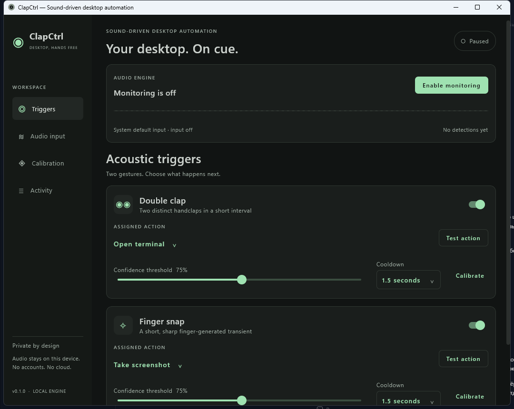

# ClapCtrl

**Control your desktop with sound.** Local acoustic automation with Kotlin, Compose Desktop and a bundled JVM. No account, cloud audio, telemetry or speech recognition.

ClapCtrl captures real microphone PCM, extracts spectral/temporal features, recognizes Double Clap and Finger Snap, then executes configured desktop actions. The dashboard controls the actual resident engine and displays actual captured signal levels.



## Status

Implemented application with **114 passing tests on Windows and 114 on Ubuntu WSL**, packaged runtime launch checks on both, and real Windows microphone capture/pause/resume/background verification. **Real-world clap/snap accuracy and Arch/PipeWire/Hyprland behavior still require target-hardware evaluation.** Conservative starter rules, local calibration and an independent WAV harness are included. Synthetic tests do not establish acoustic accuracy. Exact results and Linux visual-check limitations: [verification report](docs/VERIFICATION.md).

## Features

- Two independently configured triggers with confidence thresholds and cooldowns.
- Microphone selection, PCM format negotiation, adaptive onset/FFT analysis, pause/resume and bounded recovery.
- Terminal, screenshot, lock, launcher, media, mute, Hyprland workspace and explicitly approved custom argv actions. Unsupported backends are visible.
- Guided calibration: real waveform preview, accept/reject, three-class profiles, held-out validation, import/export.
- Atomic versioned settings, bounded activity history, useful action/device errors.
- Tray pause/reopen/quit, independent background engine, minimize fallback when no tray is available.
- Native host distributions with bundled Java runtime.

## Build and start

Development requires **JDK25 LTS**. End users of packaged builds do not need Java installed. The Gradle wrapper verifies its distribution SHA-256.

```powershell
cd D:\GitHub\clapctrl-main
.\gradlew.bat test :app-desktop:classes
.\gradlew.bat :app-desktop:run
```

Linux uses `./gradlew` (or `bash ./gradlew` if an archive lost executable permissions). Keep development data/cache in this checkout:

```powershell
$env:GRADLE_USER_HOME="$PWD\.gradle-user-home"
.\gradlew.bat :app-desktop:run --args="--data-dir=$PWD\.local-data"
```

Settings default to `%APPDATA%\clapctrl` or `$XDG_CONFIG_HOME/clapctrl` (normally `~/.config/clapctrl`). `--data-dir` overrides settings, profile and screenshot paths for portable/development use.

## Package and install

```powershell
.\gradlew.bat :app-desktop:createDistributable
# app-desktop/build/compose/binaries/main/app/ClapCtrl/ClapCtrl.exe
.\gradlew.bat :app-desktop:packageMsi
# MSI additionally requires compatible WiX tooling
```

Keep the entire portable `ClapCtrl` directory together; it includes its jlink runtime. Ready Windows MSI/ZIP and Linux x86-64 tar.gz are in `packaging/dist`, with SHA256 sidecars. See [packaging instructions](packaging/README.md) for installation, Arch recipe, source snapshots and clean uninstall. Native packages must be built on their target OS. On Arch, use `makepkg --dir packaging/arch` from the repository root, then install its `.pkg.tar.zst` with pacman. The Arch build/install itself has not been verified. No autostart is enabled automatically.

## First use

1. In **Audio input**, refresh/select your microphone.
2. Click **Enable monitoring** and accept the local microphone explanation. Input stays off on every launch until explicitly enabled.
3. In **Triggers**, assign Double Clap → Open terminal and Finger Snap → Take screenshot, or choose another supported action.
4. **Test action** runs the configured action directly; inspect the result in **Activity**. It does not simulate sound recognition.
5. Adjust confidence, sensitivity, cooldown and clap interval (default150–700ms).
6. Close to tray and reopen/pause/quit from its menu. If no tray exists, choose Minimize or Quit.

Custom commands have an executable and one argument per line, with explicit approval. Spaces stay inside each argument; shell quotes and concatenation are unnecessary. Execution uses the current user's privileges and a configurable timeout.

## Calibrate and evaluate

Open **Calibration**, enable live input, choose examples per class (default10), and Start session. Make one sound at a time. The app freezes the captured sound and asks Handclap, Finger snap, Other sounds, or Discard; answer to continue. No class needs to be selected beforehand. All three counters must reach the target, then collection pauses automatically. Wait for the350ms settling hint after clicks. Pause/resume and Undo help correct collection. Save profile & enable actions uses runtime confidence thresholds in held-out folds; the previous profile is preserved if a class fails80% precision/recall or10% FPR gates. The default10 is per class:30 accepted sounds total. Click the fixed Save profile & enable actions button; after successful validation the profile is saved and automatic actions are enabled. Optional recognition testing can be exited from any page using Enable desktop actions. Last sound and Last action explain rejection and show saved screenshot paths. These engineering gates are not a real-world guarantee.

Profiles follow microphone characteristics rather than OS name. Select a specific microphone for stable association; the system default can change physical hardware. Profiles import/export feature statistics only. Raw audio is never saved. See [calibration guide](docs/CALIBRATION.md) for independent WAV recordings, confusion matrices and annotated latency evaluation.

## Privacy and limitations

Audio is processed locally. No network audio, telemetry, account, continuous recording or hidden startup exists. Waveforms remain transient in memory; profiles contain derived features. Activity is memory-only. Screenshot actions intentionally save desktop PNGs. Monitoring is visible in the dashboard/tray, and Quit releases input.

Claps/snaps overlap acoustically and may be confused with typing, music or desk taps. Accuracy depends on microphone, room, gain and distance. Feedback sounds/output selection, spectrogram, raw-recording export, portal screenshot fallback and automatic autostart registration are not implemented. Numbered Windows workspace switching is unsupported. Resource/latency targets require extended hardware measurement.

## Architecture and documentation

`core` owns models/DSP/calibration/configuration; `platform` owns Java Sound and OS actions; `app-desktop` owns controller/lifecycle/Compose/tray. One resident process, bounded capture/event buffers and immediate busy rejection avoid IPC and growing action queues.

- [Architecture](docs/ARCHITECTURE.md), [ADR](docs/adr/0001-resident-engine.md), [audio pipeline](docs/AUDIO_PIPELINE.md)
- [Calibration](docs/CALIBRATION.md), [platform support](docs/PLATFORM_SUPPORT.md), [troubleshooting](docs/TROUBLESHOOTING.md)
- [Development](docs/DEVELOPMENT.md), [verification](docs/VERIFICATION.md), [contributing](CONTRIBUTING.md), [agent context](AGENTS.md)

Next: a consented real-audio corpus, Arch/Omarchy/PipeWire and tray verification, extended CPU/memory measurement, measured classifier improvements. The existing Apache-2.0 license is retained.
